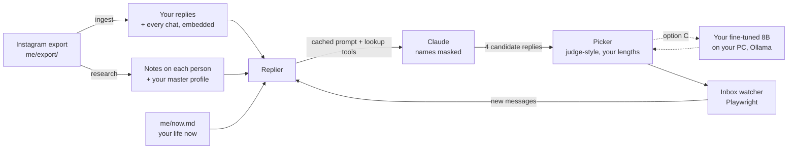

# Replace Me

[](https://github.com/HaiCLOP/Replace_Me/actions/workflows/tests.yml)

**Build an AI copy of yourself that answers your Instagram DMs the way you actually text.**

It learns from your own chat export: your words, spelling, slang, how long your replies are, who you swear with
and who you don't, what's going on in your life, and what you and each friend have talked about before. It
replies to several people at once, keeps a chat open for a couple of minutes when someone's actively texting,
and can look things up in your old chats ("what happened on 17th April?").

Then it's **measured**: a blind judge model gets your real reply and the copy's reply to the same moment and has
to pick the real one. 50% fooled means it can't tell you apart.

```
python -m replace_me eval --n 30 --seed 7
...
BLIND JUDGE: fooled 15 of 30 (50%; 50% = indistinguishable)
```

> Built and measured on one real person's chats (16k replies, Hinglish). The path from 5/30 to 15/30 is in
> [docs/EVALUATION.md](docs/EVALUATION.md): what worked, what didn't, and by how much.

## How it works



1. **Ingest:** your export becomes (a) every reply you ever sent, paired with what it answered, and (b) all your
   chats in overlapping 10-message chunks, embedded locally for search.
2. **Research:** a strong model reads each chat once and writes a note on how you are with that person, then a
   master profile of you. Plain markdown in `me/people/`: read it, fix it.
3. **Reply:** for each new message the copy gets your profile, that person's note, your life right now, 16 of
   your real replies to similar messages, and tools to search your chats. It writes 4 candidates; a picker that
   thinks like the blind judge chooses one, held to your real mix of reply lengths.
4. **Option C (optional):** a small model fine-tuned on your replies, running on your own PC, rewrites each
   candidate in your exact words before the pick. Free to train on Kaggle.

Details: [docs/ARCHITECTURE.md](docs/ARCHITECTURE.md).

## Quick start

Needs Python 3.11+, an [Anthropic API key](https://console.anthropic.com), and your Instagram export.

```bash
git clone https://github.com/HaiCLOP/Replace_Me.git && cd Replace_Me
python -m venv .venv && . .venv/bin/activate      # Windows: .venv\Scripts\activate
pip install -e .
playwright install chromium

cp .env.example .env                               # add ANTHROPIC_API_KEY
python -m replace_me init                          # creates me/profile.yaml, me/now.md
# download your export into me/export/ (me/export/README.md), fill in me/profile.yaml

python -m replace_me ingest                        # your replies + chat memory
python -m replace_me research people               # notes on each person (one model call per chat)
python -m replace_me research me                   # your master profile

python -m replace_me chat --as sam.k               # talk to your copy in the terminal first
python -m replace_me eval --n 30                   # blind test
python -m replace_me login                         # log in to Instagram yourself, once
python -m replace_me run                           # answer your DMs
```

Step by step, with what each command costs: [docs/SETUP.md](docs/SETUP.md).

## Commands

| Command | What it does |
|---|---|
| `init` | Copies the templates in `me/` to their real names (never overwrites). |
| `ingest` | Reads `me/export/` → your replies (`.data/corpus.*`) and chat memory (`.data/chats.*`). |
| `research people` / `research me` | Notes on each person / your master profile. `--only <chat>` for one, `--force` to redo. |
| `chat --as <username>` | Your copy in the terminal, as if that person was texting. Nothing goes to Instagram. |
| `eval --n 30 --seed 7 [--life]` | Blind test against your real replies → `reports/`. |
| `login` | Opens the browser so you log in yourself. The session is saved in `browser_profile/`. |
| `run` | Watches your inbox and replies. Stops and tells you if Instagram shows a security check. |
| `mute mute\|unmute <username>` | Replies off/on for someone. |
| `finetune dataset` | Training set + Kaggle notebook + Ollama Modelfile → `finetune/out/`. |
| `finetune lora-to-gguf` | Converts the trained adapter to GGUF if Kaggle didn't produce one. |

## Your data and privacy

- Everything about you lives in `me/` and `.data/`, and git ignores both. Only empty templates are in the repo.
- Names and usernames are replaced with stable codes (`Pk3f`, `@Hq9a`) in everything sent to a cloud model, and
  put back in the reply. Your fine-tuned model runs on your PC and sees real text.
- Only people you score 90+ in `me/profile.yaml` can hear about your other chats.
- It never asks anyone for money, OTPs or passwords, and it never gets around a login or security check.

Read [docs/PRIVACY.md](docs/PRIVACY.md) before you run it: your chats contain other people's messages.

## Is this allowed?

Automating your own account goes against Instagram's terms, and they may restrict accounts that act like bots.
Use it on your own account, at your own risk, with human-like timing on (`HUMAN_TIMING=true`). Many people will
be upset to find out they were texting a bot. Tell the people who matter, and use `mute` for anyone who
shouldn't get it. The copy answers honestly if someone asks whether it's a bot, unless you listed that account
in `bot_aware_handles`.

## Docs

| | |
|---|---|
| [SETUP](docs/SETUP.md) | Install, export, profile, first run |
| [ARCHITECTURE](docs/ARCHITECTURE.md) | Every module and how a reply is made |
| [EVALUATION](docs/EVALUATION.md) | The blind test, and what moved the score |
| [FINE_TUNING](docs/FINE_TUNING.md) | Train your own 8B model free on Kaggle, run it with Ollama |
| [PRIVACY](docs/PRIVACY.md) | What leaves your PC, and what doesn't |
| [TROUBLESHOOTING](docs/TROUBLESHOOTING.md) | Things that went wrong and the fix |
| [AGENTS.md](AGENTS.md) | For AI coding agents working on this repo |

## License

MIT. See [LICENSE](LICENSE).
